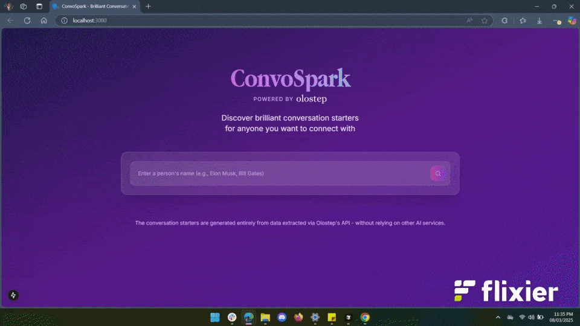
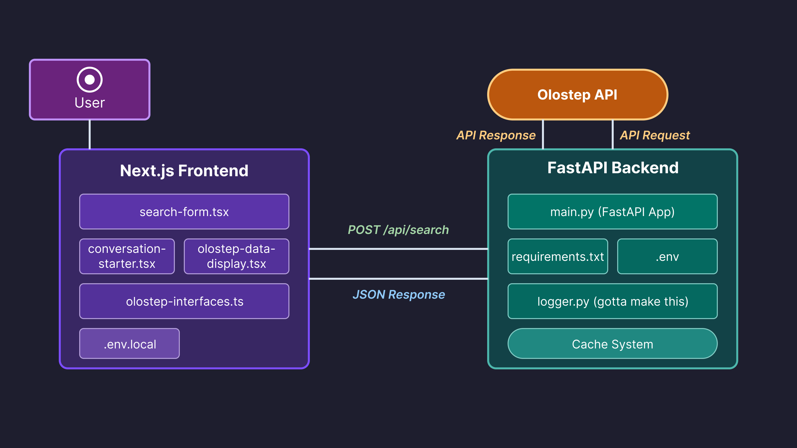

<div align="center">
  
  <h3>conversation starter generator powered by search insights</h3>
</div>

<div align="center">
  
  
  
  
  
</div>

<div align="center">
  
</div>

## what is convospark?

_convospark is a smart conversation starter generator that leverages search data to help you connect meaningfully with anyone. simply enter a name, and get personalized, contextually relevant conversation starters based on publicly available information._

## features

- 🔍 **intelligent search**: utilizes olostep's powerful web scraping api with google search parser integration
- 💬 **personalized starters**: generates contextually relevant conversation prompts based on a person's background
- ⚡ **blazing fast**: optimized caching system for quick repeat searches
- 🎨 **clean ui**: minimalist interface built with next.js and tailwindcss

## getting started

### backend setup

_(runs on port 8000 by default)_

1. `cd backend`
2. `python -m venv venv`
3. `source venv/bin/activate` (unix/mac) or `venv\Scripts\activate` (windows)
4. `pip install -r requirements.txt`
5. create a `.env` file with:
   ```
   OLOSTEP_API_KEY=your_olostep_api_key (GO GRAB IT RN IF YOU DONT HAVE ONE)
   ```
6. `uvicorn main:app --reload`

### frontend setup

_(runs on port 3000 by default)_

1. `cd frontend`
2. `npm install`
3. create a `.env.local` file with:
   ```
   NEXT_PUBLIC_API_URL=http://localhost:8000
   ```
4. `npm run dev`

## how it works

convospark uses the olostep api to intelligently scrape google search results for a given name. the application then:

1. processes the search data through our custom analysis pipeline
2. identifies key topics, achievements, and interests related to the person
3. generates contextually relevant conversation starters based on this information
4. provides you with 5 personalized icebreakers to choose from

all of this happens in seconds, with a smart caching system to make repeat searches virtually instant.

## api architecture



## technologies

- **frontend**: next.js, typescript, tailwindcss, react
- **backend**: fastapi, python, asyncio
- **data**: olostep api with google search parser

## development roadmap

- [ ] user authentication for saved searches
- [ ] expanded result analysis for deeper insights
- [ ] integration with additional data sources
- [ ] mobile app version

## contribution

contributions are welcome! please feel free to submit a pull request.

---

made with ❄️ by a founding engineer at [olostep](https://olostep.com)
